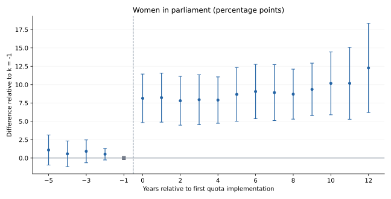

# Gender Quotas and Human Capital

Code and data from my dissertation research.

I study how the introduction of gender quotas relates to women's representation in parliament and indicators of human capital, including education, health, and women's participation in the economy.

The project uses cross-country panel data and the QAROT gender-quota database. The analysis compares outcomes before and after quota implementation, accounting for differences between countries and common changes over time.

The most consistent finding across the checked specifications is an increase in women's parliamentary representation after quota implementation. The same checks do not provide robust statistical evidence of improvements in human capital.



## Explore the project

The detailed research notes linked below are currently in Russian.

- [Main study](dissertation/README.md) — data, methods, results, and limitations.
- [Validation report](dissertation/VALIDATION.md) — what was reproduced and where the dissertation text and code differ.
- [Related studies](related-studies/README.md) — earlier work on political representation, institutions, and militarisation.
- [Data sources](data/README.md).

## Reproduce the analysis

Tested with Python 3.11. From the repository root:

```bash
python -m pip install -r requirements.txt
python dissertation/run_analysis.py --spec main
```

The main specification uses data for 1997–2015. Results are saved to `results/dissertation/main/`. Historical estimates and the new checks are stored separately so that their outputs do not overwrite each other.
